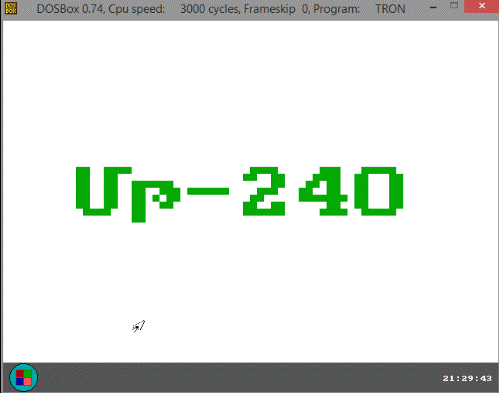
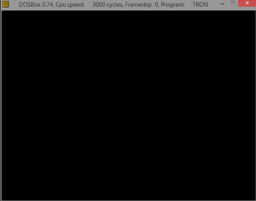
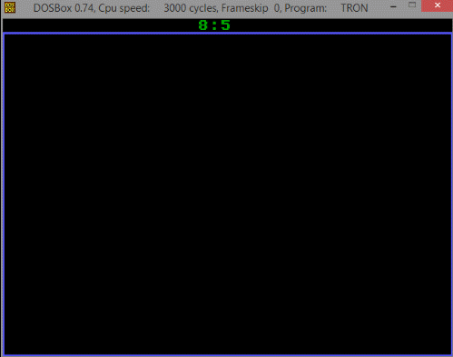

# pascal Course Work

This is my course work that I wrote in Pascal and Assembler, I did it in the second year of studying at SEUA.
Then I still was a novice in programming, so do not judge strictly :smile:

## How to run
The game is a DOS program, so it runs in [DOSBox Staging](https://www.dosbox-staging.org/). From the repository folder:

    dosbox --set keyboard_layout=us -c "mount c ." -c "c:" -c "cd \bin" -c "font /a" -c "tron.exe"

`FONT /A` loads the Armenian font the menus are written in. `keyboard_layout=us` stops DOSBox from switching to its own Armenian code page, which shows some letters wrong.

## Files
- `src/_main/TRON.PAS`: the main program (desktop, Tron, Problem 547).
- `src/_main/GRMOUSE.PAS`: the graphical mouse unit, written in assembler.
- `bin/`: the ready-to-run game with the files it needs (`EGAVGA.BGI`, `FONT.COM`).

## Demonstration
[**YouTube**](http://www.youtube.com/watch?v=uPadzHyEbVo)

## Screenshots
### Desktop

### Tron: logo

### Tron: game

